# shellundo

**Undo for every coding agent. Even what it did in the shell.**

> **Status: concept.** Nothing to install yet. This README describes what is being built.
> If you want it, star the repo and add a 👍 to [issue #1](../../issues/1). The amount of interest decides whether it ships.



*The animation above is a mockup of the planned behavior, not a recording.*

---

## The problem

Coding agents run shell commands. Shell commands delete, move and overwrite files. Built-in undo often does not see them.

- **Claude Code**: `/rewind` restores the edits made through its file tools. Per the [official checkpointing docs](https://code.claude.com/docs/en/checkpointing#bash-command-changes-not-tracked), a file that only Bash commands changed is not tracked and stays as it is. Subagent edits to other files are not restored either.
- **Codex CLI**: `/undo` was removed in early 2026. The requests to bring back file undo are still open: [openai/codex#9203](https://github.com/openai/codex/issues/9203) and [openai/codex#11626](https://github.com/openai/codex/issues/11626).
- **Git** only saves what you committed. Untracked files, ignored files (`.env`, local data, generated assets) and work in progress between two commits are gone.

## What shellundo will do

```bash
npx shellundo init      # install snapshot hooks for your agents (Claude Code and Codex first)
# ... use your agent as usual ...
shellundo undo          # restore every file changed or deleted during the last agent turn
```

- **Snapshot before each agent turn.** Incremental and content-addressed, so unchanged files cost nothing.
- **Catches shell effects.** Deleted, renamed and overwritten files are restored, whatever tool the agent used.
- **No git required.** Snapshots live outside your repository and never touch your history or branches.
- **Undo the undo.** The current state is saved before every restore.
- **Preview first.** `shellundo undo --dry-run` lists what would change.
- **Local only.** No account, no network, no telemetry.

After each run, shellundo shows what it saved you:

```
✔ 37 files restored (37 deleted by shell commands)
```

## Planned commands

| Command | What it does |
|---|---|
| `shellundo init` | Detects installed agents and adds snapshot hooks |
| `shellundo undo` | Restores the state before the last agent turn |
| `shellundo list` | Shows recent turns with the files each one touched |
| `shellundo diff <turn>` | Shows what changed during a turn |
| `shellundo jump <turn>` | Restores the state before any listed turn |
| `shellundo stats` | Files protected and restored so far |

## Roadmap

1. Claude Code and Codex CLI
2. Gemini CLI, OpenCode, GitHub Copilot CLI
3. Cursor and other agents that expose hooks
4. Generic `shellundo watch` mode for any agent

## How it compares

| | Restores agent file edits | Restores what shell commands deleted | Works without git | Several agents |
|---|---|---|---|---|
| Claude Code `/rewind` | Yes | Only for files Claude had already edited (per its docs) | Yes | Claude Code only |
| Codex CLI | No file undo today | No | n/a | Codex only |
| Git | Committed files only | Committed files only | n/a | Yes |
| **shellundo (planned)** | Yes | Yes | Yes | Yes |

Other agents (Copilot CLI, OpenCode, Gemini CLI) ship their own rewind or restore commands, each with its own scope. This table will be completed and kept factual as the project grows. Corrections are welcome.

## FAQ

**Why not just use git?**
Git is great for what you commit. Agents also touch untracked files, ignored files and uncommitted work. shellundo covers the time between your commits.

**Will it slow my agent down?**
The goal is a snapshot under one second on a typical repository. Large build folders are skipped by default and the ignore list is configurable.

**Where are snapshots stored?**
In a local folder outside the repository, cleaned up automatically after a configurable period.

## Help shape it

- 👍 [Issue #1](../../issues/1) if you want this.
- Tell us in that issue which agent you use and the last file an agent destroyed.

## License

MIT, see LICENSE.
